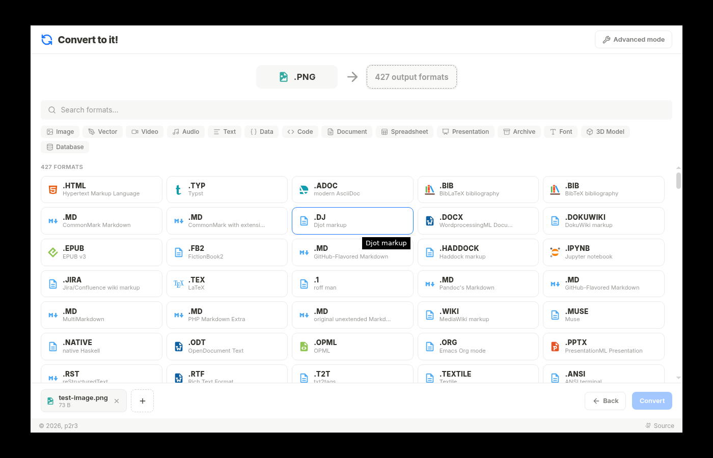

# Convert to it! — نسخة ديسكتوب أوفلاين (بـ "Open with" وتحديث تلقائي)

<div align="center">
  
</div>

**[convert.to.it](https://p2r3.github.io/convert/)** محوّل ملفات شغال بالكامل *جوه جهازك*
(كل التحويلات بتتم محليًا بـ WASM، ومفيش أي ملف بيترفع لأي سيرفر). النسخة دي حوّلته
لأبليكشين ديسكتوب حقيقي (Electron) بيتسطّب على ويندوز، وفيه الحاجتين اللي طلبتهم:

| الميزة | إزاي بتشتغل |
|---|---|
| **"Open with Convert to it"** | الأبليكشين مسجّل على **+558 امتداد** (صور، فيديو، صوت، مستندات، أرشيف، فونتات، موديلات 3D، ملفات بيانات…). كليك يمين على أي ملف → **Open with** → **Convert to it**، والملف بيفتح جوه المحوّل على طول. كمان فيه **File → Open File…** و**Ctrl+O** جوه الأبليكشين. |
| **تحديث تلقائي** | الأبليكشين بيبص على GitHub كل ما يفتح وكل 6 ساعات. لو فيه نسخة جديدة بينزّلها في الخلفية وهيتسطّب لوحده أول ما تقفل الأبليكشين — **مش هتنزّل حاجة بإيدك تاني**. |
| **أوفلاين 100%** | كل محركات التحويل (FFmpeg, ImageMagick, Pandoc, Typst, FluidSynth, SQLite, 7-Zip, Clang/LLVM, pdf.js…) جوه الأبليكشين نفسه. شيل النت وحوّل عادي. |

> **لو بتقرأ ده جوه الريبو على GitHub** يبقى خطوات 1 و2 و3 خلصت — روح على طول
> لكلمة **Actions** فوق، ولو أول مرة اضغط **«I understand my workflows, go ahead
> and enable them»**، والبناء هيبدأ لوحده. لما يخلص نزّل الأبليكشين من **Releases**.

---

## خطوات التشغيل (مرة واحدة، ~10 دقايق)

> ليه محتاج GitHub؟ عشان التحديث التلقائي محتاج "سيرفر" بينزّل منه النسخ الجديدة.
> GitHub بيبني الأبليكشين لك **مجانًا** على سيرفراته، وبينشر النسخ في Releases،
> والأبليكشين بياخد التحديثات من هناك. مفيش سيرفر تدفع فيه، ومفيش كورسات.

### 1) نزّل الملف وفكّ الضغط

نزّل **`convert-to-it-desktop.zip`** وفكّه (Right-click → Extract All).
هيطلع لك فولدر `convert-to-it-desktop` جواه الملفات دي:
`package.json` · `src/` · `scripts/` · `build/` · `.github/` · `LICENSE` · `README.md` …

### 2) اعمل repository جديد على GitHub

- روح [github.com/new](https://github.com/new) (لو معندكش حساب: [Sign up](https://github.com/signup) — مجاني)
- **Repository name:** `convert-to-it`
- اختار **Public** (عشان يبقى مجاني بالكامل)
- **متضغطش** على "Add a README file" — سيبه فاضي
- اضغط **Create repository**

### 3) ارفع الملفات ← دي الخطوة المهمة

- في صفحة الريبو الفاضي، اضغط على اللينك الصغير **«uploading an existing file»**
- **افتح فولدر `convert-to-it-desktop`** اللي فككته، ودوس جواه **`Ctrl+A`**
  عشان تختار **الملفات اللي جوه** (مش الفولدر نفسه)
- اسحب الملفات المحددة للمنطقة المخصوصة
- لازم تشوف في القايمة `package.json` و`.github` و`src` و`scripts` و`build`
  **من غير أي فولدر زيادة فوقهم** — لو شايف فولدر `convert-to-it-desktop`
  أو `app` جوه القايمة، يبقى سحبت الفولدر غلط: دوس **Cancel** وابدأ تاني من `Ctrl+A`
- تحت، اضغط **Commit changes**

> **ليه بيتهيأجش البناء؟** عشان كده بالظبط. GitHub بيقرأ الأوتوميشن بس من
> `.github/workflows/` في **أول** الريبو. لو رفعت الفولدر كله جوه فولدر تاني،
> الملف بيبقى في `app/.github/workflows/…` ومحدش بيشوفه. عشان كده بنرفع
> **الملفات اللي جوه**.

### 4) استنى البناء يخلص

- من غير ما تعمل حاجة، تاب **Actions» هيبدأ البناء لوحده
  (لو أول مرة طلب منك تأكيد: **«I understand my workflows, go ahead and enable
  them»**)
- بياخد من **5 لـ15 دقيقة** (بيحمّل Electron + أبليكشين 300 ميجا، ويبني نسخة
  ويندوز وماك ولينكس)
- لما يخلص هيبقى لونه أخضر ✅

### 5) نزّل الأبليكشين وثبّته

- روح على **[Releases](https://github.com/JouQarena/convert-to-it/releases)**
  (أو `/releases` جنب About)
- نزّل **`Convert-to-it-Setup-x64.exe`** (~190 ميجا)
- شغّله. لو Windows SmartScreen عمل تحذير: **More info → Run anyway**
  (الأبليكشين مش موقّع بشهادة مدفوعة، فـ Windows بيحذر على أي أبليكشين جديد)
- خلاص. 🎉

---

## بعد ما يتسطّب

**تفتح ملف إزاي؟** كليك يمين على الملف → **Open with** → **Convert to it**
(بالنسبة للامتدادات المسجّلة هيظهرلك **«Open with Convert to it»** على طول في
المنيو). الملف هيفتح جوه الأبليكشين، تختار الصيغة اللي عايزها من الـ398 صيغة،
وتدوس **Convert**.

**التحديث:** سيبه شغال وخلاص. لما يلاقي نسخة جديدة هيبوّنلك إشعار صغير، وهيتسطّب
أول ما تقفل الأبليكشين. مفيش تحميل يدوي.

**عايز ترجّع الوضع زي الأول؟** (الأبليكشين بيبقى هو الافتراضِي للامتدادات اللي
سجّلها) → **Settings → Apps → Default apps** وبدّل أي امتداد عايزه.

---

## كريديت

المشروع الأصلي كله **convert.to.it** من عمل **[PortalRunner (p2r3)](https://github.com/p2r3)**،
منشور تحت رخصة **GPL-2.0**:

- الموقع: <https://p2r3.github.io/convert/>
- الكود: <https://github.com/p2r3/convert>
- الرخصة: <https://www.gnu.org/licenses/old-licenses/gpl-2.0.html>

اللي عملته هنا مجرد **تغليف** (packaging): سكربتات electron-builder + إعدادات
"Open with" + التحديث التلقائي، من غير أي تعديل على المحوّل نفسه. الكريديت كله
لصاحب المشروع، والرخصة محفوظة في `LICENSE` و`THIRD-PARTY-NOTICES.md`، والكريديت
باين كمان في نافذة **Help → About** جوه الأبليكشين وفي نص الـRelease.

---

## أسئلة متوقعة

**الأبليكشين محتاج نت؟** لأ. كل حاجة جواه. النت بس اللي بياخد بيه التحديثات.

**ملفاتي بترفع فين؟** في جهازك. المحوّل شغال WASM جوه الأبليكشين — نفس اللي
الموقع بيعمله بالظبط.

**عندي ماك / لينكس؟** نزّل من نفس الـ Release: `Convert-to-it-arm64.dmg`
(ماك أبل سيليكون) أو `Convert-to-it-x64.AppImage` (لينكس). نفس الميزات بتشتغل هناك.

**عايز أضيف امتداد جديد؟** عدّل `build.fileAssociations` في `package.json`
واعمل commit — البناء هيعيد نفسه ويحدّث النسخة تلقائيًا.

**عايز أبني النسخة على جهازي بدل GitHub؟**
```bash
npm install
npm run assets      # بينزّل نسخة convert.to.it الأوفلاين (~310 ميجا)
npm run dist:win    # أو dist:mac / dist:linux
```
(محتاج Node 20+ و7-Zip على الويندوز)

**التفاصيل التقنية:** [`README-TECHNICAL.md`](README-TECHNICAL.md)
